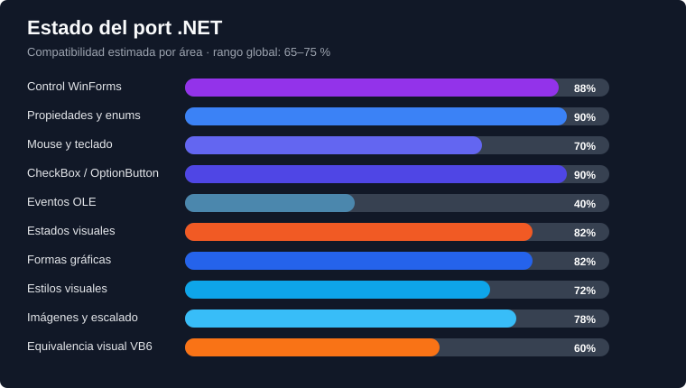

# LaVolpe Buttons .NET

Port de `lvButtons_H` (VB6/ActiveX) a un control personalizado **C# .NET 8 WinForms**.

> Busca compatibilidad funcional y visual con el control original, pero **no** es un reemplazo binario del OCX ni afirma paridad del 100 %. El porcentaje estimado y la evidencia de cada área están en [ESTADO-PORT-NET.md](ESTADO-PORT-NET.md).

Inspired by the original LaVolpe Buttons control for VB6. This project is an independent .NET implementation and does not contain the original VB6 source code.

## Estado del port .NET



El rango global estimado es **65–75 %**. Las barras resumen la compatibilidad
por área; la metodología, la evidencia y las limitaciones están documentadas
en [ESTADO-PORT-NET.md](ESTADO-PORT-NET.md).

La paleta visual está validada en Visual Studio: los estados normal, hover,
pulsado y foco funcionan, y sus valores se conservan al cerrar y reabrir el
diseñador. El rango global no cambia porque siguen pendientes la licencia
upstream y la paridad visual completa con VB6.

## Estado actual

El control compila sin errores ni advertencias y cuenta con una suite de pruebas ejecutable. Las funciones verificadas por ejecución incluyen:

- Modos `CommandButton`, `CheckBox` y `OptionButton` con la semántica de VB6 para `Value`, selección de hermanos, `GotFocus` y supresión del clic sobre una opción ya elegida.
- `Caption`/`Text` sincronizados, `IButtonControl`, `DialogResult`, `Default`, `Cancel` y navegación con teclado.
- 8 estilos de fondo, 9 formas, regiones reales de ventana (incluidas diagonales, elipses y máscaras de imagen), bordes de tres anillos por estilo, degradado XP, foco, hover y estados pulsado/marcado/deshabilitado.
- Gradientes en cuatro direcciones y paleta derivada de `BackColor`.
- Imágenes con las colocaciones y tamaños del original, `MouseIcon` con hotspot centrado, `MousePointerConstants` y `ToolTipText`.
- Compatibilidad de API: `hDC`, `hwnd`, `Index`, `DelayDrawing(bool)`, `RedrawButton()`, `DragIcon`, alias `lv_*` de los enums y eventos `Lv*`.
- 79 pruebas automáticas de compatibilidad (ver [Pruebas](#pruebas)).

Todavía hay diferencias conocidas; consulte [Limitaciones](#limitaciones-y-diferencias-conocidas).

## Estructura

| Ruta | Contenido |
| --- | --- |
| `LaVolpe.Buttons.Net/` | Biblioteca WinForms con el control `LaVolpeButton`. |
| `LaVolpe.Buttons.Sample/` | Aplicación de ejemplo con estilos, formas, modos, imágenes y gradientes. |
| `LaVolpe.Buttons.DesignerSample2/` | Formulario WinForms limpio con un `LaVolpeButton` para validar el diseñador de Visual Studio. No activa drag-and-drop. |
| `LaVolpe.Buttons.Tests/` | Harness STA de compatibilidad y herramientas de captura/comparación. |
| `LaVolpe.Buttons.XunitTests/` | Runner xUnit v3/Microsoft Testing Platform para las pruebas complementarias. |
| `LaVolpe.Buttons.Net.sln` | Solución .NET (biblioteca, ejemplo y pruebas). |
| `LaVolpe-Buttons-Updated-/` | Código VB6 original de referencia (no forma parte de la compilación). |
| `ESTADO-PORT-NET.md` | Estado del port, porcentaje estimado y evidencia por área. |
| `Tutorial.md` | Guía paso a paso para usar `LaVolpeButton` en Visual Studio. |
| `COMPATIBILIDAD.md` | Matriz de compatibilidad por propiedad, método y evento. |
| `PRUEBAS_COMPATIBILIDAD.md` | Casos ejecutados, resultados y pendientes. |
| `AUDITORIA_VB6_NET8.md` | Auditoría del control VB6 y del port .NET. |
| `EVIDENCIA_Y_DIFERENCIAS.md` | Evidencia y diferencias conocidas. |

## Requisitos

- Windows.
- .NET 8 SDK con soporte `net8.0-windows`.
- Visual Studio 2022 o la CLI de `dotnet`.

El repositorio incluye `global.json` para seleccionar el SDK .NET 8.0.427 cuando está instalado.

## Compilar

```powershell
dotnet restore .\LaVolpe.Buttons.Net.sln
dotnet build .\LaVolpe.Buttons.Net.sln --configuration Release --no-restore -m:1
dotnet build .\LaVolpe.Buttons.Net\LaVolpe.Buttons.Net.csproj --configuration Release
dotnet build .\LaVolpe.Buttons.Sample\LaVolpe.Buttons.Sample.csproj --configuration Release
dotnet build .\LaVolpe.Buttons.Tests\LaVolpe.Buttons.Tests.csproj --configuration Release
```

`-m:1` mantiene la compilación de la solución estable en entornos donde el SDK cancela procesos Roslyn al compilar los proyectos WinForms en paralelo.

## Ejecutar el ejemplo

```powershell
dotnet run --project .\LaVolpe.Buttons.Sample --configuration Release
```

## Usarlo en una aplicación WinForms

Consulta también el [Tutorial de Visual Studio](Tutorial.md) para añadir el control al Toolbox, colocarlo en el diseñador y guardar sus propiedades.

Añade una referencia a `LaVolpe.Buttons.Net.csproj` o a la DLL publicada y crea el control desde código:

```csharp
var aceptar = new LaVolpeButton
{
    Caption = "Aceptar",
    ButtonStyle = BackStyle.WindowsXp,
    Mode = ButtonMode.CommandButton,
    DialogResult = DialogResult.OK,
    Size = new Size(120, 36)
};

aceptar.Click += (_, _) => MessageBox.Show("Pulsado");
Controls.Add(aceptar);
AcceptButton = aceptar;
```

El control es WinForms (`net8.0-windows`); no se puede colocar directamente en WPF, ASP.NET o MAUI.

El ejemplo recorre los 8 `ButtonStyle`, las 7 formas no personalizadas, los tres modos, los botones `Default`/`Cancel`, un gradiente, una imagen y una forma `CustomFlat` generada desde la máscara de una imagen.

## Pruebas

```powershell
dotnet run --project .\LaVolpe.Buttons.Tests --configuration Release
```

El ejecutable crea formularios reales en un hilo STA, comprueba la API y las regiones, imprime `PASS`/`FAIL` por caso y devuelve código de salida `1` si algo falla. No requiere xUnit, NUnit ni paquetes externos.

Para ejecutar la misma suite mediante el runner estándar:

```powershell
dotnet test .\LaVolpe.Buttons.XunitTests\LaVolpe.Buttons.XunitTests.csproj --configuration Release
```

## Verificar el arrastre OLE desde Visual Studio

Abre `LaVolpe.Buttons.DesignerSample2/LaVolpe.Buttons.DesignerSample2.csproj` para validar el control desde el diseñador de Visual Studio. El formulario nuevo solo contiene un `LaVolpeButton`; no configura drag-and-drop ni recursos externos.

## Publicar

> **Aviso de licencia:** el issue #17 sigue abierto. El paquete se puede generar
> localmente para pruebas, pero no debe publicarse en `nuget.org` ni redistribuirse
> hasta verificar los términos del proyecto VB6 original y de sus recursos.

Para consumir la biblioteca desde NuGet:

```powershell
dotnet add package LaVolpe.Buttons.Net --version 1.0.0
```

Para generar el paquete localmente:

```powershell
dotnet pack .\LaVolpe.Buttons.Net\LaVolpe.Buttons.Net.csproj --configuration Release --no-restore --output .\artifacts\nuget
```

```powershell
dotnet publish .\LaVolpe.Buttons.Sample\LaVolpe.Buttons.Sample.csproj `
  --configuration Release `
  --output .\artifacts\publish
```

## Características

### Apariencia

- `BackStyle`: `Windows95`, `Windows31`, `WindowsXp`, `Java`, `Flat`, `Hover`, `Netscape` y `Macintosh`.
- `ButtonShape`: `Rectangular`, `LeftDiagonal`, `RightDiagonal`, `FullDiagonal`, `Round3D`, `Round3DFixed`, `RoundFlat`, `CustomFlat` y `Custom3DBorder`.
- Los enums del PropertyGrid muestran los nombres compatibles con VB6 (`lv_*`/`vb*`) y sus valores numéricos, sin duplicar los alias internos de C#; por ejemplo, `ButtonStyle` ofrece 8 estilos y `CaptionStyle` ofrece `lv_Default`, `lv_Sunken` y `lv_Raised`.
- En el diseñador de Visual Studio, `Mode` (`CheckBox`/`OptionButton`), `ButtonShape`, `ButtonStyle`, `CaptionStyle`, `GradientMode`, `CustomClick`, `DragMode`, `FontStyle`, `HoverColorLocks`, `MousePointer`, `PictureAlign` y `PictureSize` se serializan y reaparecen al guardar y reabrir el formulario; usan `DesignerSerializationVisibility`, convertidores ligados al tipo real, `ShouldSerializeXxx` y `ResetXxx`.
- El nuevo `DesignerSample2` parte de una plantilla WinForms limpia y no incluye `Form1.resx` ni recursos binarios. Así se evita el bloqueo MSB3821 del editor de recursos de Visual Studio.
- Regiones de ventana reales: diagonales calculadas como el VB6, elipses completas en las formas redondeadas y recorte de esquinas según el estilo (`LopOffCorners`).
- En `CustomFlat`/`Custom3DBorder` la región se genera desde la imagen: el píxel superior izquierdo actúa como color transparente (también se descarta alpha < 20).
- Colores derivados de `BackColor`/`HoverBackColor` mediante el mismo desplazamiento de canales que `ShadeColor`; bordes de tres anillos concéntricos con colores por estilo y estado, más el degradado vertical fijo de XP.
- `GradientMode`: `LeftToRight`, `RightToLeft`, `TopToBottom`, `BottomToTop`.
- `CaptionStyle` (`Default`, `Sunken`, `Raised`), `CaptionAlign`, `FontStyle` y `ShowFocusRect`.
- `Picture`, `PictureAlign` y `PictureSize` (`16x16`, `24x24`, `32x32`, `FillStretch`, `FillScaleUpDown`).
- `Palette` opcional para personalizar desde el diseñador los fondos normal, hover, pulsado, marcado y deshabilitado, los colores de texto y el foco; los colores `Empty` conservan el renderer VB6 por defecto. `ResetPalette()` y `ResetDefaultColors` restauran la configuración.

### Comportamiento

- `Mode`: `CommandButton`, `CheckBox`, `OptionButton`.
- Accesibilidad: el `AccessibleRole` se adapta automáticamente a `CommandButton`, `CheckBox` u `OptionButton`, y `Caption` inicializa `AccessibleName` cuando no se ha definido otro.
- `Value`/`Checked`/`Selected`; en `CommandButton` se rechaza `Value = true`, como en VB6.
- `OptionButton`: deselecciona hermanos, se selecciona al recibir foco y no dispara `Click` si ya estaba elegido.
- CheckBox/OptionButton marcan toda la superficie con `cCheckBox`, igual que `Style = Graphical`; no hay glifo independiente.
- `IButtonControl`: `DialogResult`, `NotifyDefault`, `Default` y `Cancel`.
- Hover con temporizador administrado de 50 ms **por control**, activo solo mientras el puntero está sobre el botón; evento `MouseOnButton`.
- `MouseIcon` con hotspot centrado y liberación del `HICON`; `MousePointer` usa `MousePointerConstants` y `MouseIcon` implica `Custom`.
- `DragIcon` crea un cursor propio con `CreateIconIndirect` y lo usa durante el arrastre.
- `DelayDrawing(bool)`, `BeginDelayDrawing()`, `EndDelayDrawing()` y `RedrawButton()`.
- Eventos `ValueChanged`, `CheckedChanged`, `SelectedChanged`, `ButtonDoubleClick`, `LvMouseDown/Up/Move`, `LvKeyDown/Up`, `LvKeyPress`, además de los eventos WinForms habituales.
- Propiedades de compatibilidad: `hDC`, `hwnd`, `Index`, `HelpContextID`, `WhatsThisHelpID`, `BackColorButton`, `ResetDefaultColors`.
- Alias `lv_*` en los enums para facilitar el traslado de código VB6.

## Estado de compatibilidad pendiente

La API funcional principal de `lvButtons_H` ya está implementada y verificada en
WinForms. No obstante, no es correcto declarar una equivalencia del 100 % mientras
queden estas diferencias objetivas:

- `HelpContextID` se integra con un `ContextHelpProvider` asignado desde código:
  registra el ID como `HelpNavigator.TopicId` y activa/desactiva la ayuda según
  el valor. `WhatsThisHelpID` usa el `WhatsThisHelpProvider` explícito como
  equivalente WinForms basado en `HelpNavigator.TopicId`.
- `Index` se conserva y se puede recuperar desde `sender` en cualquier evento del
  control. WinForms no recrea automáticamente los `Control Array` de VB6; para
  identificar cada instancia se usa la combinación `sender` + `Index`.
- `DragMode` conserva los valores `vbManual`/`vbAutomatic`, pero el ciclo OLE se
  adapta a WinForms y no reproduce el sistema ActiveX binario del OCX.
- `hWnd`, `hDC`, `StdPicture`, `PropertyBag`, CLSID, registro del OCX y persistencia
  binaria no pueden ser idénticos en una biblioteca WinForms administrada.
- La pintura, las regiones personalizadas y la normalización de imágenes son
  funcionalmente equivalentes, pero no se ha demostrado igualdad píxel a píxel.
- La validación DPI disponible es lógica; falta una comparación física del OCX y
  del control .NET en monitores reales de 120, 144 y 192 DPI.
- La licencia del código VB6 original y de algunas imágenes upstream sigue sin
  estar verificada; por eso el paquete no debe publicarse como si relicenciara el
  OCX original.

Estas diferencias no impiden utilizar el control en Visual Studio como control
WinForms; delimitan únicamente la compatibilidad binaria, visual y legal con el
OCX VB6 original.

## Limitaciones y diferencias conocidas

- **No hay compatibilidad COM/ActiveX**: no se conservan CLSID, PropertyBag, registro del OCX ni el diseñador de VB6.
- **Pintado aproximado**: los tres anillos, focos y paletas se reproducen con GDI/GDI+, incluidos los colores independientes por lado en estilos rectangulares y diagonales; no se garantiza igualdad píxel a píxel con el control original.
- **Formas personalizadas**: VB6 y el port redimensionan proporcionalmente el control al asignar `Picture`/`ButtonShape`; la normalización GDI no es binariamente idéntica. El caption sólo aparece en modo CheckBox/OptionButton con `Value = True`.
- **Máscara de imagen**: se usa el píxel superior izquierdo (±3 por canal) o alpha < 20. Si el control supera 250 000 píxeles, se usa un rectángulo para evitar regiones costosas. Una imagen ya liberada se ignora al recalcular la región.
- **`DrawToBitmap` no respeta `Region`**: para comprobar el recorte de ventana hay que usar `Region.IsVisible` o una captura real de pantalla.
- **Eventos OLE adaptados**: `OLEDragDrop`, `OLEStartDrag`, etc. son equivalentes WinForms, no OLE real.
- **`Index` no crea un arreglo automático**: el control conserva el índice y los
  eventos entregan la instancia mediante `sender`, que es el modelo equivalente
  de WinForms.
- **Ayuda**: `HelpContextID` requiere asignar un `ContextHelpProvider` y
  `WhatsThisHelpID` un `WhatsThisHelpProvider`, ambos con su `HelpNamespace`
  configurado. WinForms no tiene el modo WhatsThis binario de VB6; la integración
  usa `HelpNavigator.TopicId` de forma explícita.
- **Timer**: es un `System.Windows.Forms.Timer` de 50 ms, no el timer Win32 nativo del OCX.

## Recursos e imágenes

`LaVolpe.Buttons.Net/Resources/*.png` se extrajeron de `frmSample.frx` con `extract_frx_images.py` (requiere Pillow, no es dependencia de compilación):

```powershell
python .\extract_frx_images.py
```

La muestra reutiliza esos PNG tal como venían del proyecto original. Algunos pueden ser logotipos de terceros: si va a distribuir el proyecto, revise su licencia o reemplácelos por recursos propios. El código del port es MIT, pero eso no concede derechos sobre esas imágenes.

## Documentación

- [ESTADO-PORT-NET.md](ESTADO-PORT-NET.md) — estado y porcentaje estimado por área.
- [COMPATIBILIDAD.md](COMPATIBILIDAD.md) — matriz de compatibilidad.
- [PRUEBAS_COMPATIBILIDAD.md](PRUEBAS_COMPATIBILIDAD.md) — pruebas ejecutadas y pendientes.
- [AUDITORIA_VB6_NET8.md](AUDITORIA_VB6_NET8.md) — auditoría técnica.
- [EVIDENCIA_Y_DIFERENCIAS.md](EVIDENCIA_Y_DIFERENCIAS.md) — evidencia y diferencias.

## Licencia

El código nuevo del port .NET se distribuye bajo MIT; consulte [LICENSE](LICENSE).
El port deriva de **LaVolpe Buttons (Updated)**, publicado en Planet Source Code
como código 45279. El `@PSC_ReadMe` original advierte que el autor podía
conservar derechos, por lo que esta atribución no se interpreta como una
relicencia del código VB6 original ni de las imágenes. Los comentarios de
`lvButtons.ctl` acreditan la inspiración de Gonchuki y la fórmula de colores
XP de Gonchuki y Ghuran Kartal. Verifique los términos originales antes de
redistribuir el port o sus recursos.
La referencia de Chameleon Button se conserva en el espejo de [Planet Source
Code](https://github.com/Planet-Source-Code/malachi-chameleon-button-an-awesome-multi-style-button__1-28761);
su fuente identifica copyright ©2001 de Gonchuki, pero no se encontró una
licencia explícita de redistribución. Este proyecto no copia ni relicencia ese
código VB6 ni sus imágenes.
La evidencia revisada y la decisión de alcance están detalladas en
[NOTICE.md](NOTICE.md); el MIT del port no relicencia el código VB6, el OCX ni
las imágenes originales.
